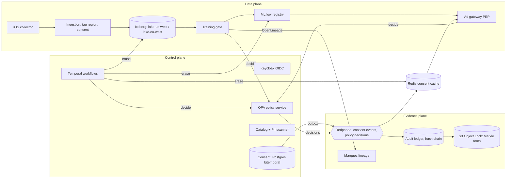
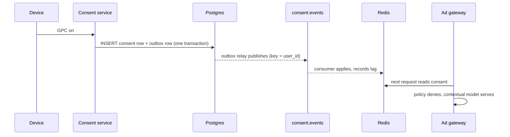

# Custodian: design doc

Status: implemented as a hosted demo; production path specified here.
Owner: Data and AI Governance.

## 1. Problem

Every AI workload in the company (ads ranking, assistant LLM fine-tuning,
search analytics, and the next one) reads personal data. Today the controls that
make this lawful live in people's heads and in per-team checks: who may read
which dataset, for what purpose, whether a user's consent reached the serving
path, which data trained a model, and whether an erased user is really gone.
Custodian is one governance plane that every workload plugs into. The ads
ranking pipeline (iPhone events, federated ranker) is the first integration and
the main demo path. Regulators
(GDPR, CCPA/CPRA, DMA, EU AI Act) require these controls to be **enforced** and
**provable**, not documented.

## 2. Goals and non-goals

Goals
- Every read of governed data is decided by policy with an explicit purpose.
- Consent changes reach serving in seconds; anything unknown fails closed.
- Training sets are built from consent as it was known at the snapshot.
- Erasure reaches every copy, including table snapshots, caches and models.
- Every decision is recorded in a tamper-evident ledger an auditor can verify.

Non-goals
- Rewriting any workload's models or collectors.
- Real personal data. Synthetic users only.
- Replacing the company IdP or warehouse; Custodian wraps them.

## 3. Functional requirements

| Area | Requirement |
|---|---|
| Identity | OIDC for humans (6 roles), client credentials for services, JIT grants with expiry, break-glass with audit, RFC 8693 for agents |
| Consent | Bitemporal records per user and purpose; sources: settings, ATT, personalized ads toggle, GPC, DSR; outbox to `consent.events` |
| Catalog | Register datasets with owner, steward, classification, PII, region, legal basis, purposes, retention; PII scan proposes tags; pending until approved |
| Policy | PDP/PEP split; decision = allow, reasons, bundle version; shadow bundles; fail closed |
| Workflows | Access request (pre-check, privacy, legal if restricted, grant with conditions, auto revoke); DSR saga; retention |
| Lakehouse | Region-partitioned buckets; ingestion tags region and consent at write; erasure expires snapshots |
| Lineage | OpenLineage per job; training records snapshot IDs; queries by model and by user |
| ML | Scoped training tokens, policy gate, point-in-time consent join, model card, `retrain_required` |
| Serving | Consent from cache, policy per request, contextual fallback, circuit breaker, decision logging |
| Audit | Hash chain, periodic Merkle root to WORM, keyed pseudonyms, auditor-only queries, evidence export |

## 4. Non-functional requirements and SLOs

| SLO | Target | How measured |
|---|---|---|
| Policy decision latency | p99 < 10 ms at 1,000 rps | OPA decision histogram; demo shows in-process p99 |
| Consent propagation | p95 < 5 s outbox to Redis | `recorded_at` to cache apply, per message |
| Personalized without allow | exactly 0 | gateway invariant counter, alert on any increment |
| DSR completion | inside 30 days, target 72 h | saga SLA timer with escalation at 21 days |
| Ledger integrity | verification passes daily | scheduled verify job plus anchor comparison |

Reliability: idempotency keys on every saga step, transactional outbox, retries
with exponential backoff, dead letter topics, circuit breaker on the PDP,
graceful degradation to the contextual model. No PII in logs; correlation IDs
on every span.

## 5. Architecture

### Data flow: consent change

## 6. Threat model (STRIDE)

| Threat | Example | Mitigation |
|---|---|---|
| Spoofing | Service impersonates the trainer | mTLS + client credentials, audience-bound short tokens |
| Tampering | DBA edits a denial into an allow | Hash chain + Merkle roots in Object Lock; daily verify |
| Repudiation | Reviewer denies approving access | Approvals signed by token subject, ledgered with workflow ID |
| Information disclosure | Ledger leaks user IDs | Keyed HMAC pseudonyms, key in KMS, auditor-only reads |
| Denial of service | PDP outage | Fail closed to contextual model, breaker, cached bundles |
| Elevation of privilege | Analytics grant used for ads | Purpose is part of every decision and every token scope |

## 7. Alternatives considered

See `adr/`. Summary: OPA over Cedar (ecosystem, Rego test tooling, sidecar
maturity); Iceberg over Delta (engine neutrality, snapshot expiry semantics we
depend on, REST catalog); Temporal over Airflow (long-running human steps,
durable timers, sagas); dataset-level lineage plus snapshot IDs over row-level
lineage (cost; user location answered by partition and snapshot membership).

## 8. Rollout

1. Shadow: PDP evaluates beside existing checks, decisions logged, no enforcement.
2. Enforce at the training gate (lowest blast radius, batch).
3. Enforce at serving behind a flag per region, EU first.
4. Turn on erasure saga for new DSRs; backfill open ones.
5. Each policy change ships as a shadow bundle first; promote when disagreement is understood.

## 9. Open questions

- Pseudonym key rotation: re-key the ledger, or keep a key version per entry?
- Model unlearning vs retraining for `retrain_required`: cadence and threshold.
- Consent for minors: age assurance source and default state per region.
